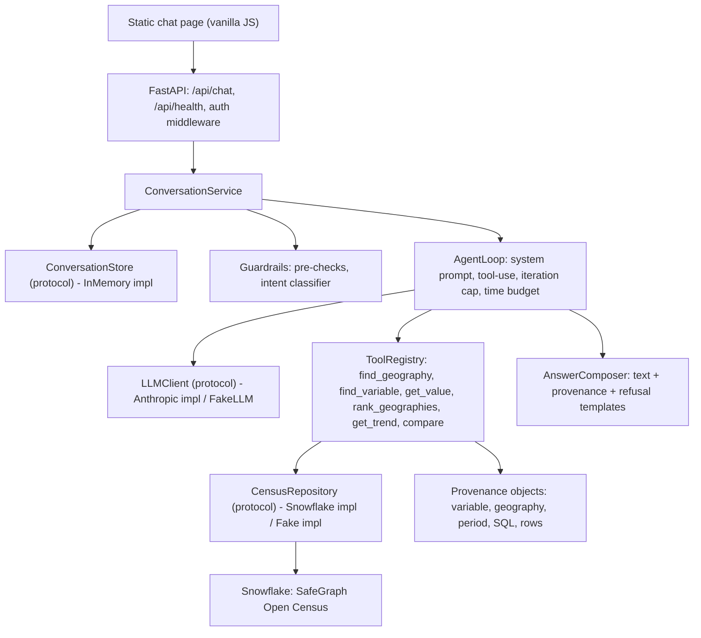

# Architecture

Miniflake is a data-grounded chat agent that answers natural-language questions about the US population using American Community Survey data served from Snowflake. This document describes the system's components and their boundaries. Which components exist at any moment is tracked in [docs/roadmap.md](docs/roadmap.md); the rationale behind each choice is in [docs/adr/](docs/adr/).

**Current implementation (S0–S9):** `app/config.py` (pydantic-settings), `app/main.py` (FastAPI app factory with lifespan warm-up), `app/logging.py` (structured JSON logging to stderr, plus a local JSON lines file when `LOG_FILE` is set), `app/warmup.py` (Snowflake connection warm-up), `app/api/` (`GET /api/health`, `POST /api/login`, `GET /api/session`, `POST /api/chat`, `POST /api/conversations/reset`, demo auth middleware, error envelope, request-id middleware, static file serving), `web/` (vanilla JS chat page with provenance expander and login form), `app/conversation/` (`ConversationStore` protocol, `InMemoryConversationStore`, `ConversationService`, `ResolvedContext`, history windowing), `app/guardrails/` (deterministic pre-checks, intent classifier, YAML patterns and templates, `GuardrailPipeline`), `app/data/` (`CensusRepository` protocol, `SnowflakeCensusRepository`, `FakeCensusRepository`, SQL templates, rollup logic, token-based variable search with catalog aliases, batch geography lookup, `connection.py`), `app/tools/` (six typed tools, `ToolRegistry`, discriminated `ToolResult` outcomes, LLM descriptions in `descriptions.yaml`), `app/llm/` (`LLMClient` protocol, `AnthropicLLMClient`, `FakeLLM`, strict-schema sanitization), `app/agent/` (`AgentLoop` with per-turn search-call budget, file-based system prompt with recently-discussed context, `AnswerComposer` with typed outcome rules, per-turn transcript, error templates), `scripts/chat_cli.py`, `scripts/discover_schema.py`, `scripts/setup_secrets.sh`, `scripts/deploy.sh`, `scripts/smoke_deployed.py`, `deploy/cloudrun.env`, `evals/` (golden set, runner with offline re-scoring, scoring, reports), fixtures under `fixtures/`, Dockerfile, CI workflow.

## Principles

- Answers come from data returned by tools, never from model memory. Every number in an answer traces back to a tool result and the provenance is returned with the answer.
- The LLM never writes SQL. It selects typed tools and fills their parameters; SQL is templated and parametrized inside the data layer.
- Every external dependency (LLM, database, conversation storage) sits behind a protocol with a fake implementation, so the whole request path is testable without network access.
- Adjustable values (model ids, timeouts, limits, warehouse names) live in configuration, never in code or documentation.

## Component overview



### Request lifecycle

1. The browser posts a message and a session cookie to `POST /api/chat`.
2. Auth middleware validates the HMAC-signed demo cookie on protected routes (`/api/chat`, `/api/conversations/*`); `/api/health`, `/api/login`, `/api/session`, and the static page stay open. The API layer wraps everything in a request-level time budget and a uniform error envelope.
3. `ConversationService` loads the conversation from `ConversationStore`, appends the user turn, and passes the history plus resolved context (last geography, measure, period) to the guardrails.
4. Guardrails run deterministic pre-checks, then an intent classification. Off-topic or harmful input is answered with a templated refusal without touching the data layer. Underspecified input is answered with a clarification.
5. `AgentLoop` calls the LLM with the system prompt, conversation history and tool schemas. The LLM either answers or requests tool calls; the loop executes tools through `ToolRegistry`, feeds results back, and repeats until the model answers, the iteration cap is hit, or the time budget expires.
6. Tools call `CensusRepository`, which runs parametrized SQL against Snowflake and returns typed rows plus a `Provenance` record. For count fields at state, county, place or nation level the repository sums block-group values; median and rate fields at those levels return `UnsupportedRequest`. Tools return typed results including explicit `Ambiguous`, `NotFound`, `PeriodUnavailable` and `UnsupportedRequest` outcomes.
7. `AnswerComposer` produces the final text and attaches provenance.
8. The assistant turn and updated context are saved; the response is returned to the browser, which renders the text and an expandable provenance panel.

## Layers and boundaries

| Layer | Package | Responsibility | Depends on |
| :--- | :--- | :--- | :--- |
| Web UI | `web/` | Static chat page: login form, message list, loading state, outcome badges, provenance expander, error display. Vanilla JS with `fetch`. | API contract only |
| API | `app/api/` | Routes, demo auth middleware (HMAC-signed cookie), static file serving, error envelope, request timeout. | Conversation |
| Conversation | `app/conversation/` | `ConversationStore` protocol, in-memory TTL implementation, `ConversationService` orchestrating guardrails and agent. | Guardrails, Agent |
| Guardrails | `app/guardrails/` | Pre-checks, intent classifier, refusal and clarification templates. | LLM |
| Agent | `app/agent/` | Tool-use loop, system prompt file, `AnswerComposer`. | LLM, Tools |
| LLM | `app/llm/` | `LLMClient` protocol, Anthropic implementation, scripted `FakeLLM`. | Provider SDK |
| Tools | `app/tools/` | Six typed tools (`find_geography`, `find_variable`, `get_value`, `rank_geographies`, `get_trend`, `compare`), `ToolRegistry`, discriminated `ToolResult` outcomes, provenance. | Data |
| Data | `app/data/` | `CensusRepository` protocol, Snowflake implementation, fake implementation, SQL templates, variable and geography catalog. | Snowflake connector |
| Config | `app/config.py` | pydantic-settings model holding every adjustable value. | Environment |

Dependencies point downward only. Nothing below the Agent layer imports from the Agent layer; nothing below Tools knows about the LLM.

## Extension points

- **New tool**: add a module in `app/tools/` with a pydantic input model, a result model and a `run(repository, input)` function, then register it in `ToolRegistry`. The LLM discovers it through the registry's generated schemas.
- **New data source**: implement `CensusRepository` (or a sibling protocol for a different domain) in `app/data/` and wire it in `app/main.py`.
- **Different LLM provider**: implement `LLMClient` in `app/llm/` and select it via configuration.
- **Persistent conversation storage**: implement `ConversationStore` and select it via configuration.

See [docs/EXTENDING.md](docs/EXTENDING.md) for step-by-step instructions.

## Package layout

```
app/
  main.py              FastAPI app factory, dependency wiring
  config.py            pydantic-settings (all adjustable values)
  api/                 routes, auth middleware, error envelope
  conversation/        ConversationStore protocol + in-memory impl, service
  agent/               loop, prompts/ (system prompt as file), composer
  llm/                 LLMClient protocol, anthropic client, fake
  tools/               one file per tool + registry
  data/                CensusRepository protocol, snowflake impl, fake impl, sql templates, catalog
  guardrails/          pre-checks, classifier, pipeline, templates
web/                   index.html, app.js, styles.css
tests/                 unit/, component/, e2e/, live/
evals/                 questions.yaml, run_evals.py, loader, scoring, reference, report, rescore, reports/
fixtures/              catalog snapshots, sample rows for fakes
scripts/               schema discovery, catalog snapshot, deploy
docs/                  requirements, roadmap, specs, ADRs, decision log
```

## Runtime topology

A single container runs FastAPI with uvicorn and serves both the API and the static UI. It is deployed to Google Cloud Run with secrets injected from Secret Manager as environment variables. By default the service scales to zero when idle and to at most one instance under traffic, with CPU allocated only while requests are in flight and no startup CPU boost. A request that arrives while no instance is running pays the container cold start, and background warm-up then runs alongside that request rather than ahead of it. Setting `CLOUD_RUN_MIN_INSTANCES=1` and `CLOUD_RUN_CPU_ALWAYS_ALLOCATED=true` restores a single warm instance whose warm-up resumes the warehouse before the first user request. Cloud Run settings (instance count, concurrency, request timeout, CPU, memory) are expressed in `deploy/cloudrun.env` and applied by `scripts/deploy.sh`.

On startup, a daemon thread runs `warm_up`: it opens the Snowflake connection and executes a trivial geography lookup so chat requests do not pay warehouse resume latency once it completes. Structured JSON logs to stdout include request id, conversation id, outcome, latency, tool call names and durations, LLM token usage, and Snowflake query duration. Message content is truncated at info level.

Snowflake is reached over the Python connector using a dedicated service user with key-pair authentication and a read-only role. The LLM is reached over the Anthropic Messages API.

## Data model

The agent works over the [SafeGraph US Open Census listing](https://app.snowflake.com/marketplace/listing/GZSNZ2UNN0/safegraph-us-open-census-data-neighborhood-insights-free-dataset) on Snowflake Marketplace. ACS 5-year estimates are stored at census block group grain in wide tables (one row per block group, ACS field codes as columns such as `B01003e1`), with metadata tables for field descriptions and FIPS-to-geography mapping. Exact Snowflake table names are documented in [docs/data/dataset.md](docs/data/dataset.md) after S0 discovery.

**Native geography level:** `BlockGroup` (12-digit FIPS).

**Derived levels** (via FIPS prefix and metadata): `Nation`, `State`, `County`. Place and CBSA are not in the share; optional S10 (public-data supplement) was cut.

**Aggregation policy:**

| `aggregation_kind` | Block group | Rolled-up geography |
| :--- | :--- | :--- |
| `count` | Direct read | `SUM` across block groups; provenance records `aggregation_method: sum` |
| `median`, `rate` | Direct read | Not supported; returns `UnsupportedRequest` |

A snapshot of the variable catalog (with `aggregation_kind` tags) and supported geographies is stored under `fixtures/` and drives both the fake repository and the tool descriptions given to the LLM. `fixtures/variable_catalog_spec.yaml` names the curated series, their topic and aggregation kind, and optional `aliases` (phrases a user may say for the series).

**Variable search** (`search_variables` in both repositories, helpers in `app/data/search_utils.py`): the query is split into significant tokens (stopwords dropped, count capped) and a field matches when every token appears in its title, field label or id, in any order. A series whose alias tokens all overlap the query tokens (shared stem) is included regardless of wording. The SQL template receives generated parametrised `LIKE` clauses and an optional alias `IN` list; the fake applies the same rule in Python and the contract tests hold the two to parity.

**Batch geography names**: `get_geographies(geo_ids)` resolves names for many geo ids in one query; `rank_geographies` and `compare` use it instead of one lookup per row.

## Tool layer

Each tool returns a discriminated `ToolResult` with a `kind` field:

| Kind | Meaning |
| :--- | :--- |
| `success` | Data and provenance from repository calls |
| `ambiguous` | Multiple plausible matches; `hint` guides disambiguation |
| `not_found` | No match; optional `suggestions` from relaxed search |
| `period_unavailable` | Geography and variable exist but not for the requested vintage |
| `unsupported_request` | Well-formed but not expressible (e.g. median at county level) |
| `tool_error` | Repository failure; `retryable` indicates whether to retry |

`ToolRegistry.schemas()` emits provider-neutral JSON Schema for enabled tools. `dispatch` validates input, runs the tool, and maps repository errors to `ToolError` without propagating exceptions.

## LLM layer

`LLMClient` in `app/llm/client.py` defines a provider-neutral contract: `Message` with `TextBlock`, `ToolUseBlock`, `ToolResultBlock`, and `OpaqueBlock` (for passthrough of provider thinking blocks). `AnthropicLLMClient` uses the official Anthropic SDK with strict tool schemas, configurable model, effort, and thinking mode. Registry schemas are sanitized in the client before `strict: true` is applied. `FakeLLM` replays scripted responses for deterministic component tests.

## Agent core

`AgentLoop` in `app/agent/loop.py` builds the system prompt from `app/agent/prompts/system.md` plus rendered tool, geography, topic, vintage, and recently-discussed summaries; calls the LLM with tool schemas from `ToolRegistry`; dispatches tool calls; echoes assistant content verbatim (including opaque thinking blocks); records a per-turn transcript for conversation storage; and stops on `end_turn`, iteration cap, or wall-clock budget. Catalog searches (`find_variable`, `find_geography`) are counted per turn; past `AGENT_MAX_SEARCH_CALLS` the loop does not dispatch the call and instead records an `unsupported_request` result telling the model to explain what could not be found. The system prompt states both the time and the search budget.

`AnswerComposer` in `app/agent/composer.py` labels the outcome from typed signals only, never from the wording of the reply: timeout, iteration cap and LLM errors are `error`, as is a trailing `tool_error`. With data-tool traces (`get_value`, `rank_geographies`, `compare`, `get_trend`) any `success` is `answer`, all `ambiguous` is `clarify`, otherwise `unanswerable`. With catalog-only traces, any `ambiguous` is `clarify`, otherwise `unanswerable`. A turn with no tool traces is `unanswerable`, unless the guardrail pipeline marked it a capability turn (`ungrounded_answer_allowed`), in which case it is `answer` with empty provenance. `scripts/chat_cli.py` runs a single turn against Snowflake and Anthropic for manual iteration.

## Conversation and API

`ConversationStore` in `app/conversation/store.py` is a protocol; `InMemoryConversationStore` holds full turn transcripts and `ResolvedContext` in process memory with idle TTL and turn-boundary trimming. `ConversationService` validates input, runs guardrails, loads history, injects resolved facts into the agent, and saves updated context and transcript. `POST /api/chat` runs the service under a hard request timeout in a worker thread; `POST /api/conversations/reset` clears server-side history. An anonymous session cookie identifies the conversation. Errors use a uniform envelope with `request_id`.

## Guardrails

`GuardrailPipeline` in `app/guardrails/pipeline.py` composes two layers before the agent loop:

1. **Pre-checks** (`prechecks.py`, `patterns.yaml`): length and character sanity, then regex patterns for prompt injection, SQL execution requests, and personal-data requests. Matches return a templated refusal without an LLM or data call.
2. **Intent classifier** (`classifier.py`): one structured-output call to the cheaper model (`anthropic_classifier_model`) with the last two turns as plain-text context. Intents are `in_scope`, `capability`, `needs_clarification`, `off_topic` and `harmful`. Off-topic and harmful input is refused; questions missing geography or an underspecified measure return a clarification template. `capability` (what can you answer, where does the data come from) proceeds to the agent with a `proceed` decision that carries `ungrounded_answer_allowed`, so the composer labels the no-tool reply `answer`. Omitted vintage is not a clarification: the pipeline lets the agent default to the latest ACS 5-year release. Classifier errors fail open to the agent loop and are logged.

Numeric grounding relies on tool-only data access and the system prompt; answers are not post-checked against tool payloads. Refusal and clarification texts live in `app/guardrails/templates.yaml`. Guardrail short-circuit turns are persisted as user plus assistant messages. Adjustable thresholds and toggles live in configuration (`GUARDRAIL_*`).

## Testing

Four layers: unit tests with no network, component tests with `FakeCensusRepository` and `FakeLLM`, API end-to-end tests via `TestClient` with fakes injected, and opt-in live suites against Snowflake and Anthropic. See [docs/testing-strategy.md](docs/testing-strategy.md).

## Evaluation harness

`evals/` measures the deployed agent against the golden set and is itself tested against the app with fakes.

| Module | Role |
| :--- | :--- |
| `questions.yaml` | Golden set: expected outcome per item plus optional provenance, value check, clarify slot, no-data-call constraint and `max_tool_calls` |
| `loader.py` | Validates the set; groups follow-ups with their parent so a group shares one conversation |
| `run_evals.py` | Logs in, resets once per group, posts each question, scores the raw `/api/chat` payload; filters by item, category or expected outcome; optional worker pool with one HTTP client each; `--rescore` mode |
| `scoring.py` | `ChatObservation` to `ItemResult` with typed failures (`outcome`, `clarify_slot`, `no_data_call`, `provenance`, `tool_budget`, `value`, `latency`); the observation and golden note are kept on the result |
| `reference.py` | Reference values from the repository for value checks |
| `report.py` | JSON and Markdown report: header (target, git SHA, filters, workers, re-score source), summary, per-item results with notes, failures grouped by kind |
| `rescore.py` | Re-scores a saved JSON report against the current golden set and rules offline, reusing saved reference values |

The HTTP client and question set are injectable, so `tests/e2e/test_run_evals.py` runs the whole runner in-process against the app with fakes.
