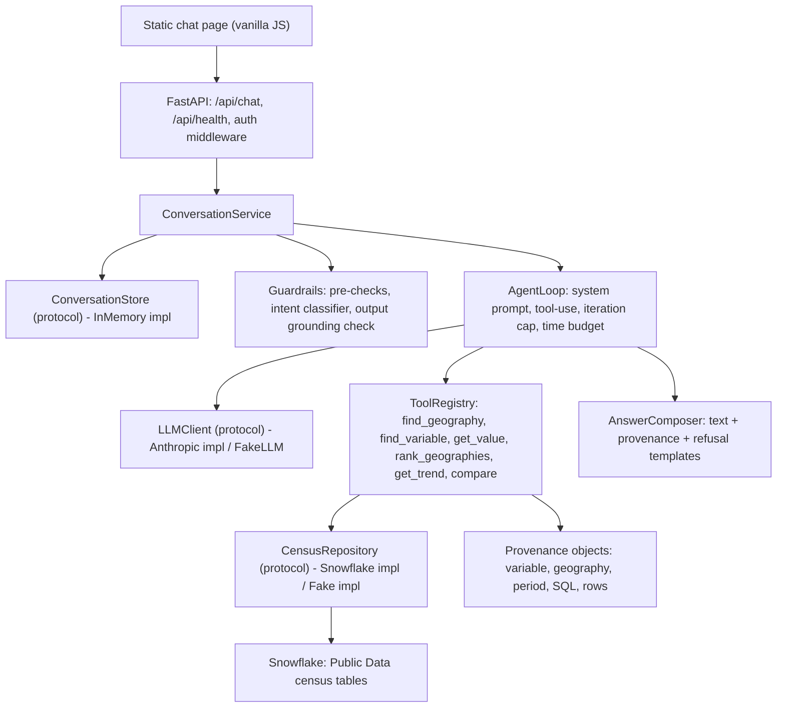

# Architecture

Miniflake is a data-grounded chat agent that answers natural-language questions about the US population using American Community Survey data served from Snowflake. This document describes the system's components and their boundaries. Which components exist at any moment is tracked in [docs/roadmap.md](docs/roadmap.md); the rationale behind each choice is in [docs/adr/](docs/adr/).

## Principles

- Answers come from data returned by tools, never from model memory. Every number in an answer traces back to a tool result and the provenance is returned with the answer.
- The LLM never writes SQL. It selects typed tools and fills their parameters; SQL is templated and parametrized inside the data layer.
- Every external dependency (LLM, database, conversation storage) sits behind a protocol with a fake implementation, so the whole request path is testable without network access.
- Adjustable values (model ids, timeouts, limits, warehouse names) live in configuration, never in code or documentation.

## Component overview



### Request lifecycle

1. The browser posts a message and a session cookie to `POST /api/chat`.
2. Auth middleware validates the demo session; the API layer wraps everything in a request-level time budget and a uniform error envelope.
3. `ConversationService` loads the conversation from `ConversationStore`, appends the user turn, and passes the history plus resolved context (last geography, measure, period) to the guardrails.
4. Guardrails run deterministic pre-checks, then an intent classification. Off-topic or harmful input is answered with a templated refusal without touching the data layer. Underspecified input is answered with a clarification.
5. `AgentLoop` calls the LLM with the system prompt, conversation history and tool schemas. The LLM either answers or requests tool calls; the loop executes tools through `ToolRegistry`, feeds results back, and repeats until the model answers, the iteration cap is hit, or the time budget expires.
6. Tools call `CensusRepository`, which runs parametrized SQL against Snowflake and returns typed rows plus a `Provenance` record. Tools return typed results including explicit `Ambiguous`, `NotFound` and `PeriodUnavailable` outcomes.
7. `AnswerComposer` produces the final text, attaches provenance, and applies the output grounding check: numbers in the text must appear in tool results, otherwise the answer is replaced with a grounded degradation message.
8. The assistant turn and updated context are saved; the response is returned to the browser, which renders the text and an expandable provenance panel.

## Layers and boundaries

| Layer | Package | Responsibility | Depends on |
| :--- | :--- | :--- | :--- |
| Web UI | `web/` | Static chat page: message list, loading state, provenance expander, error display. | API contract only |
| API | `app/api/` | Routes, demo auth middleware, error envelope, request timeout. | Conversation |
| Conversation | `app/conversation/` | `ConversationStore` protocol, in-memory TTL implementation, `ConversationService` orchestrating guardrails and agent. | Guardrails, Agent |
| Guardrails | `app/guardrails/` | Pre-checks, intent classifier, output grounding check, refusal and clarification templates. | LLM |
| Agent | `app/agent/` | Tool-use loop, system prompt file, `AnswerComposer`. | LLM, Tools |
| LLM | `app/llm/` | `LLMClient` protocol, Anthropic implementation, scripted `FakeLLM`. | Provider SDK |
| Tools | `app/tools/` | One module per tool, `ToolRegistry`, typed inputs/outputs, provenance. | Data |
| Data | `app/data/` | `CensusRepository` protocol, Snowflake implementation, fake implementation, SQL templates, variable and geography catalog. | Snowflake connector |
| Config | `app/config.py` | pydantic-settings model holding every adjustable value. | Environment |

Dependencies point downward only. Nothing below the Agent layer imports from the Agent layer; nothing below Tools knows about the LLM.

## Extension points

- **New tool**: add a module in `app/tools/` with a pydantic input model, a result model and a `run(repository, input)` function, then register it in `ToolRegistry`. The LLM discovers it through the registry's generated schemas.
- **New data source**: implement `CensusRepository` (or a sibling protocol for a different domain) in `app/data/` and wire it in `app/main.py`.
- **Different LLM provider**: implement `LLMClient` in `app/llm/` and select it via configuration.
- **Persistent conversation storage**: implement `ConversationStore` and select it via configuration.

See [docs/EXTENDING.md](docs/EXTENDING.md) for step-by-step instructions.

## Package layout

```
app/
  main.py              FastAPI app factory, dependency wiring
  config.py            pydantic-settings (all adjustable values)
  api/                 routes, auth middleware, error envelope
  conversation/        ConversationStore protocol + in-memory impl, service
  agent/               loop, prompts/ (system prompt as file), composer
  llm/                 LLMClient protocol, anthropic client, fake
  tools/               one file per tool + registry
  data/                CensusRepository protocol, snowflake impl, fake impl, sql templates, catalog
  guardrails/          pre-checks, classifier, output checks
web/                   index.html, app.js, styles.css
tests/                 unit/, component/, e2e/, live/
evals/                 questions.yaml, run_evals.py, reports/
fixtures/              catalog snapshots, sample rows for fakes
scripts/               schema discovery, catalog snapshot, deploy
docs/                  requirements, roadmap, specs, ADRs, decision log
```

## Runtime topology

A single container runs FastAPI with uvicorn and serves both the API and the static UI. It is deployed to Google Cloud Run with secrets injected from Secret Manager. During evaluation the service is pinned to a single warm instance so the in-memory conversation store is coherent and cold starts do not consume the response budget. Snowflake is reached over the Python connector using a dedicated service user with key-pair authentication and a read-only role. The LLM is reached over the Anthropic Messages API.

## Data model

The agent works over the Census Bureau source of Snowflake Public Data Products, which stores ACS estimates in long format:

- `AMERICAN_COMMUNITY_SURVEY_TIMESERIES`: one row per variable, geography and date.
- `AMERICAN_COMMUNITY_SURVEY_ATTRIBUTES`: the variable catalog (series, level, measurement type and period, unit).
- `GEOGRAPHY_INDEX`: geographies with a `level` (State, County, CBSA, Place and finer).

A snapshot of the curated variable catalog and the supported geographies is stored under `fixtures/` and drives both the fake repository and the tool descriptions given to the LLM. Details are in [docs/data/dataset.md](docs/data/dataset.md).

## Testing

Four layers: unit tests with no network, component tests with `FakeCensusRepository` and `FakeLLM`, API end-to-end tests via `TestClient` with fakes injected, and opt-in live suites against Snowflake and Anthropic. A golden question set in `evals/questions.yaml` defines expected behaviour classes and is run against the deployed stack. See [docs/testing-strategy.md](docs/testing-strategy.md).
