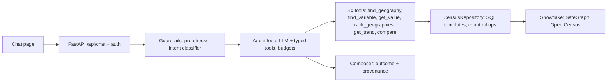

# Miniflake
<small>*Built in 24 hours as a take-home exercise, with AI coding agents doing most of the implementation against specs and tests I wrote. Scope cuts and known limits are listed in REFLECTION.md.*</small>

A data-grounded chat agent that answers natural-language questions about the US population from American Community Survey data on the Snowflake Marketplace. The model never writes SQL and never answers from memory: it selects typed query tools, the tools run parametrized SQL against Snowflake, and every figure is returned with the query that produced it. Questions the data cannot answer are declared unanswerable rather than approximated.

Author: Jerzy Marondel. The written reflection on the build is [REFLECTION.md](REFLECTION.md).

## Evaluating the demo

**Public URL:** https://miniflake-eowbm7u4ua-uk.a.run.app

**Login:** enter the demo passphrase, available from the author on request.

The chat page loads after login. The [USER-GUIDE.md](USER-GUIDE.md) describes the page, the outcome badges and the provenance panel.

**Example questions**, one per behaviour class in the golden set (`evals/questions.yaml`):

| Behaviour | Example |
| :--- | :--- |
| Lookup | *What is the population of Texas?* |
| Comparison | *Compare the population of Los Angeles County and Harris County, Texas.* |
| Ranking | *What are the five most populous states?* |
| Trend | *How has the population of Arizona changed over the available ACS vintages?* |
| Follow-up | Ask about Texas, then *And Florida?* |
| Clarify | *How many people live in Washington?* |
| Unanswerable | *What's the median household income in Cook County, Illinois?* |
| Refuse | *Write me a poem about autumn.* |
| Capability | *What kind of questions can you answer?* |

**What it can and cannot answer.** The dataset is ACS 5-year estimates at census block group grain, two vintages, from the SafeGraph US Open Census listing.

- Count measures (population, households, people in a category) at nation, state and county level, summed from block groups.
- Median and rate measures (median income, median rent) only at block group level; at county or state level they are declared unanswerable, because a median cannot be validly summed.
- City and metro (Place, CBSA) questions are unanswerable: the share carries no mapping for them.
- Several topics the catalog lists (poverty, housing, health insurance, commuting) have no populated fields in the share; the agent searches within a bounded budget and then says so.
- A year given as "2020" means the 2020 ACS 5-year estimate, not the decennial count; an omitted year means the latest vintage.

**Review-window limits.** One Cloud Run instance at most, scaling to zero when idle (the first question after an idle period pays a cold start), in-memory conversations (lost on scale-down or restart), a shared passphrase rather than user accounts. Complex lookups may exceed the 60-second target; a longer hard timeout lets them finish instead of cutting them off (see interpretations below).

## Architecture in five minutes



A turn: the API validates the demo cookie and applies a hard timeout. `ConversationService` loads the stored transcript and resolved context. Guardrails run regex pre-checks, then a cheap classifier call; off-topic or harmful input is refused before any data access, underspecified input gets a clarification. In scope, `AgentLoop` gives the model the system prompt, history and tool schemas; the model calls tools, each of which resolves names against the catalog, runs a fixed SQL template and returns a typed result (`success`, `ambiguous`, `not_found`, `period_unavailable`, `unsupported_request`) with a `Provenance` record. The composer labels the outcome from the tool traces, the turn is saved, and the page renders the answer with an expandable provenance panel.

Three principles hold throughout: numbers come only from tool results; the LLM never writes SQL; every external dependency (LLM, Snowflake, conversation store) sits behind a protocol with a fake, so the whole request path is tested without credentials. Details: [ARCHITECTURE.md](ARCHITECTURE.md). Adding a tool, data source, provider or store: [docs/EXTENDING.md](docs/EXTENDING.md).

## Key decisions

Each is an ADR with the alternatives weighed. The narrative of how they were reached, including reversals, is the [decision log](docs/decision_log.md).

| ADR | Decision | Instead of |
| :--- | :--- | :--- |
| [001](docs/adr/ADR-001-language-and-web-stack.md) | Python, FastAPI, static page, one container | Streamlit, Next.js, separate React app |
| [002](docs/adr/ADR-002-llm-provider.md) | Anthropic Messages API behind an `LLMClient` protocol; Sonnet-tier agent, Haiku-tier classifier | Cursor SDK (an agent runtime, not a completions API), Snowflake Cortex |
| [003](docs/adr/ADR-003-dataset-selection.md) | SafeGraph listing only, block-group grain | Snowflake Public Data long-format tables, which were the first default and reversed as not the named dataset |
| [004](docs/adr/ADR-004-query-strategy.md) | Typed semantic tools over SQL templates; counts summed, medians and rates refused at rolled-up levels | Text-to-SQL; weighted-median approximations |
| [005](docs/adr/ADR-005-conversation-state.md) | Server-side in-memory store behind a protocol, one instance | Client-held history; persistent store now |
| [006](docs/adr/ADR-006-hosting-and-auth.md) | Cloud Run, Secret Manager, passphrase exchanged for a signed cookie | Other PaaS, IAP/OAuth, open endpoint |
| [007](docs/adr/ADR-007-guardrails.md) | Regex pre-checks, then intent classifier, then tool-only data access; post-answer number check removed | Prompt-only; a single moderation call; a guardrail framework |
| [008](docs/adr/ADR-008-testing-strategy.md) | Protocol fakes, contract tests, opt-in live suites, golden evals as a measurement | Live-only tests; SDK mocks; evals as the development loop |
| [009](docs/adr/ADR-009-conversation-context-content.md) | Full per-turn transcript plus extracted resolved context | Text-only history with a summary |
| [010](docs/adr/ADR-010-time-and-tool-budgets.md) | 60 s as the target, longer hard cutoffs, per-turn iteration and search caps | 60 s hard kill everywhere; no inner budget |
| [011](docs/adr/ADR-011-outcome-classification.md) | Outcome from tool traces and classifier intent | Phrase matching on the reply; terminal pseudo-tools |

## Interpretations of ambiguous requirements

Several requirements leave points open ([docs/requirements.md](docs/requirements.md) section 5). The readings used:

- **"Complete responses within 60 seconds under normal conditions."** Treated as the normal-conditions target that evals score and that the system prompt states to the model, not as the hard server timeout. Agent, API and Cloud Run timeouts sit above it so a slow lookup finishes rather than being killed. [ADR-010](docs/adr/ADR-010-time-and-tool-budgets.md).
- **"US Open Census dataset from the Snowflake Marketplace."** The SafeGraph listing of that name, not Snowflake Public Data. [ADR-003](docs/adr/ADR-003-dataset-selection.md).
- **How to query the data.** Typed tools over parametrized SQL, not text-to-SQL. Count rollups by `SUM` from block groups; medians and rates at aggregate geography declared unanswerable rather than averaged. [ADR-004](docs/adr/ADR-004-query-strategy.md).
- **"No local setup required to evaluate."** A public URL behind a shared passphrase. Not a user model. [ADR-006](docs/adr/ADR-006-hosting-and-auth.md).
- **"Preserve conversation context."** Read conservatively: full server-side turn transcripts (including tool calls and results) plus resolved geography, variable and vintage, so any follow-up the model could resolve, it can. Omitted vintage on a follow-up reuses the last resolved year, otherwise the latest release; it is never a clarification. [ADR-009](docs/adr/ADR-009-conversation-context-content.md).
- **"Guardrails."** Deterministic pre-checks, then a cheap classifier; off-topic and harmful input never reaches Snowflake. Numeric grounding is tool-only data access plus prompt discipline; a post-answer number matcher was built and removed because it blocked legitimate multi-turn comparisons. [ADR-007](docs/adr/ADR-007-guardrails.md).
- **"Say so clearly rather than hallucinating."** Every "cannot answer" is a typed tool result, and the outcome label is derived from those results, not from the model's wording. [ADR-011](docs/adr/ADR-011-outcome-classification.md).
- **Provenance.** A first-class field on the API response and a panel on the page, not a log-only artefact.

## Quality signals

- Default suite (`uv run pytest`, no credentials): 333 tests across unit, component against fakes, and in-process API end-to-end, including a self-test of the eval runner. Opt-in: Snowflake contract tests parametrized alongside the fake, live agent and guardrail tests, one Playwright smoke test.
- Golden set: 53 items over 16 behaviour categories. Final live run against the deployed service: 51 pass; the two failures are `unanswerable` items answered with a clarifying question, accepted with reasons in [docs/testing-strategy.md](docs/testing-strategy.md). Latency p50 and p95 inside the 60-second target. Reports: [evals/reports/](evals/reports/).
- CI runs ruff and the default suite; pre-commit hooks mirror it.

## Running locally

Prerequisites: `uv` (provisions Python 3.12), a `.env` copied from [.env.example](.env.example) with Snowflake key-pair credentials, an Anthropic API key, and for the login page `DEMO_PASSPHRASE` and `AUTH_SIGNING_SECRET` (or `DEMO_AUTH_ENABLED=false`).

```bash
uv sync
uv run pre-commit install
uv run uvicorn app.main:create_app --factory --reload --port 8080
```

Chat page at `http://localhost:8080/`; health at `GET /api/health`. Local JSON lines logs are appended to `LOG_FILE` (gitignored) and include `stop_reason` on failed turns.

```bash
uv run python scripts/chat_cli.py "What is the population of Texas?"   # single turn, no server
uv run python scripts/discover_schema.py                                # regenerate docs/data/dataset.md
uv run pytest                                                           # default suite
RUN_LIVE_TESTS=1 uv run pytest tests/live                               # Snowflake and Anthropic
RUN_BROWSER_TESTS=1 uv run pytest tests/e2e/test_ui_smoke.py            # Playwright
DEMO_PASSPHRASE=... uv run python evals/run_evals.py --target <url>     # golden set; --rescore <report.json> re-scores offline
```

Every setting is an environment variable; names and purposes are in [docs/configuration.md](docs/configuration.md).

## Deploying

```bash
./scripts/setup_secrets.sh   # once: creates Secret Manager secrets from .env, grants the runtime account
./scripts/deploy.sh          # builds, pushes, applies deploy/cloudrun.env, runs scripts/smoke_deployed.py
```

## Repository map

- [REFLECTION.md](REFLECTION.md): process, decisions, what would change with more time, known failure modes, testing.
- [docs/adr/](docs/adr/): architecture decision records. [docs/decision_log.md](docs/decision_log.md): decisions, dead ends, deviations and cuts in order.
- [ARCHITECTURE.md](ARCHITECTURE.md), [docs/EXTENDING.md](docs/EXTENDING.md), [docs/configuration.md](docs/configuration.md).
- [docs/testing-strategy.md](docs/testing-strategy.md): layers, tradeoffs, eval results and accepted failures.
- [docs/requirements.md](docs/requirements.md), [docs/roadmap.md](docs/roadmap.md), [docs/specs/](docs/specs/): what was required, the stage plan and each stage's contract. [docs/agent-workflow.md](docs/agent-workflow.md): how work was picked up, by people and coding agents.
- [USER-GUIDE.md](USER-GUIDE.md), [CHANGELOG.md](CHANGELOG.md).
